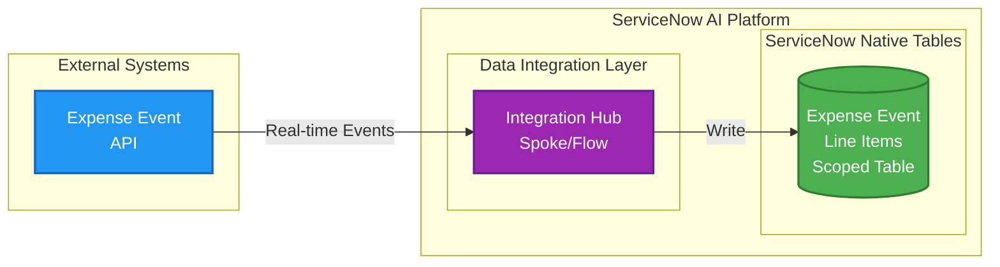

# Lab Exercise: Fundamentals

[Take me back to main page](../)

Not a fan of complicated schematics and the [Data and Flow Diagrams](../data-and-flow-diagrams.md) not to your liking? Check out a the simplified architectural view of the solution that you will be building below.

<figure><figcaption></figcaption></figure>

This lab will walk you through creation of the scoped tables needed to interact with the external system integrations.

<figure><figcaption></figcaption></figure>

## Data flow

The data flow below shows how ServiceNow will consume REST API endpoints via Integration Hub Spokes then further processed by a Flow so the entries will be written in the scoped table.

> **Color Legend:** 🟣 Workflow Data Fabric | 🟢 Platform | 🔵 External Systems
>
> [📊 View High-Resolution Diagram](https://raw.githubusercontent.com/leojacinto/WorkflowDataFabric-TypeB/main/.gitbook/assets/dataflow_fundamentals.png)

## Lab story

While you have the power of CMDB at your fingertips, the process we are solving for here does not concern CI data. You will need to create a scoped table which will store information from an expense event API. This can come from cloud services such as AWS or Azure.

The table you will create here will not be used for the rest of the lab and serves mainly to introduce how target tables for REST API endpoints are created for ServiceNow.

## Steps

### <mark style="color:$warning;">**\[Skip if already done for AI Day 1]**</mark> Install Lab Dependencies

This contains critical steps to prepare your Demo Hub Instance.

1.  Ensure you are at least in Zurich Patch 6. Go to **All** > type **stats.do** and hit Return/Enter ↵. Ensure that it is empty.

    <figure><figcaption></figcaption></figure>
2.  You should get a build tag with Zurich and the needed patch name.

    <figure><figcaption></figcaption></figure>
3. If you have not done so yet, log in to [Demo Hub](https://demohub.service-now.com/) then go to the [APAC End-to-End AI Workshop ](https://demohub.service-now.com/edsp?id=sc_cat_item\&sys_id=8bb12066fb2f761042e1f57675efdc85\&sysparm_category=f2d15f6893429250e0d5b3aa6aba105a)catalog item to install the lab dependencies in your instance.
4.  Provide your <mark style="color:green;">**a.)**</mark> Zurich Patch 6 or newer **Instance** name, <mark style="color:green;">**b.)**</mark>**&#x20;Admin User ID**, and <mark style="color:green;">**c.)**</mark> **Password**, then <mark style="color:green;">**d.)**</mark> click **Submit**.

    <figure><figcaption></figcaption></figure>
5. Wait for 10 to 15 minutes.
6. Once completed, you will get an email indicating that the import of update sets is successful.

<figure><figcaption></figcaption></figure>

## Next step

Let us continue building the data foundations for the use case. Next up is creation of the Data Fabric tables which will be used by AI Agents. Let us work on AI Agents' ability to use REST API connectivity by proceeding with the [Integration Hub configuration](https://servicenow-lf.gitbook.io/the-workflow-data-fabric-loom/main-exercises/lab-exercise-integration-hub).

[Take me back to main page](../)
