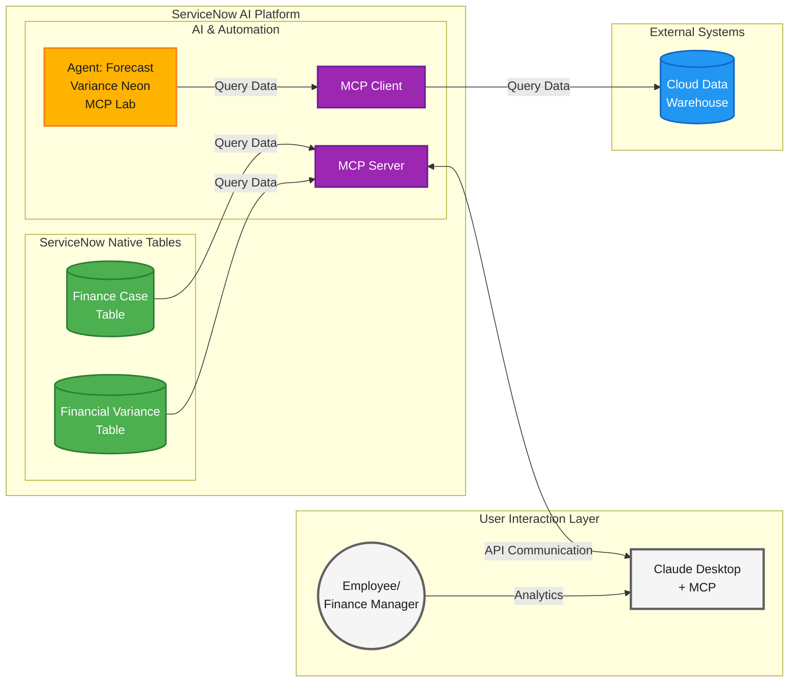

# Lab Exercise: Model Context Protocol Server/Client

## Where we are in this workshop

<figure><picture><source srcset="../.gitbook/assets/dataflow_outcome_agent_flow_mcp_dark.png" media="(prefers-color-scheme: dark)"></picture><figcaption></figcaption></figure>

> **Legend:** 🟤 Data | 🟣 Workflow Data Fabric | 🔵 External Systems | ↓ Takes data from

## Lab Exercise: Model Context Protocol Server/Client

[Take me back to main page](../)

This lab will walk you through the configuration and usage of MCP ([Model Context Protocol](https://modelcontextprotocol.io/docs/getting-started/intro)) capabilities to interact with ServiceNow either as a client or as a server, allowing end users to interact with the platform as they see fit. For simplicity, this lab will cover ServiceNow acting as an MCP Client. More details on MCP Server scenarios will be added soon.

<figure><figcaption></figcaption></figure>

<figure><figcaption></figcaption></figure>

Specifically, this provides the steps needed to connect ServiceNow to an MCP Server tool configured in Neon.

This exercise does not cover the creation of the MCP Service from Neon as that requires administrator rights and CDW expertise which may not be widely available to various personas.

### Lab Sections and Objectives

<table><thead><tr><th width="83">Step</th><th width="106">Who</th><th>Description</th></tr></thead><tbody><tr><td><a href="lab-exercise-model-context-protocol-server-client.md#data-flow">1</a></td><td>Facilitator</td><td><strong>Context Setting:</strong> Review the data flow diagram showing how ServiceNow provides MCP client and server capabilities to interact with external systems.</td></tr></tbody></table>

**MCP Client Configuration**

<table><thead><tr><th width="83">Step</th><th width="106">Who</th><th>Description</th></tr></thead><tbody><tr><td><a href="lab-exercise-model-context-protocol-server-client.md#hands-on-configure-mcp-client">2</a></td><td>Student</td><td><strong>Configure MCP Client:</strong> Navigate to AI Agent Studio Settings. Add a new MCP Server entry for Neon with API Key authentication.</td></tr></tbody></table>

**AI Agent Configuration**

<table><thead><tr><th width="83">Step</th><th width="106">Who</th><th>Description</th></tr></thead><tbody><tr><td><a href="lab-exercise-model-context-protocol-server-client.md#hands-on-configure-new-ai-agent-for-mcp-scenario">3</a></td><td>Student</td><td><strong>Configure new AI Agent:</strong> Duplicate your Forecast Variance agent (with your initials). Rename it to Forecast Variance Neon MCP Lab.</td></tr><tr><td><a href="lab-exercise-model-context-protocol-server-client.md#hands-on-configure-mcp-step-and-tool">4</a></td><td>Student</td><td><strong>Configure MCP Step and Tool:</strong> Add MCP instructions to the agent specialty. Add the variance-baseline-search MCP server tool from Neon. Configure tool name, description, and execution mode.</td></tr><tr><td><a href="lab-exercise-model-context-protocol-server-client.md#walkthrough-complete-ai-agent-configuration">5</a></td><td>Student</td><td><strong>Complete AI Agent Configuration:</strong> Accept default security controls. Configure channels and status. Save and test.</td></tr></tbody></table>

**AI Agent Testing**

<table><thead><tr><th width="83">Step</th><th width="106">Who</th><th>Description</th></tr></thead><tbody><tr><td><a href="lab-exercise-model-context-protocol-server-client.md#hands-on-test-and-review-custom-ai-agent">6</a></td><td>Student</td><td><strong>Test AI Agent:</strong> Enter test prompt to process an expense event. Verify the MCP tool returns matching cost center data from Neon.</td></tr></tbody></table>

<table><thead><tr><th width="83">Step</th><th width="106">Who</th><th>Description</th></tr></thead><tbody><tr><td><a href="lab-exercise-model-context-protocol-server-client.md#conclusion">7</a></td><td>Facilitator</td><td><strong>Conclusion:</strong> Walk through how MCP allows ServiceNow to connect to external systems using LLM-powered integrations as an alternative to traditional APIs.</td></tr></tbody></table>

### Data flow

The data flow below shows how ServiceNow provides MCP client and server capabilities.

> **Color Legend:** 🟡 Now Assist | 🟢 Platform | 🟣 Workflow Data Fabric | 🔵 External Systems | ⚪ User Interaction
>
> [📊 View High-Resolution Diagram](https://raw.githubusercontent.com/leojacinto/WorkflowDataFabric-TypeE/main/lab-guide/assets/dataflow_mcp.png)

### MCP Client Configuration

#### Hands-on: Configure MCP Client

Navigate to AI Agent Studio Settings. Add a new MCP Server entry for Neon with API Key authentication.

**Check the scope first.** The application scope (globe icon) decides where the MCP server, its alias and the agent copy are created. Click the <mark style="color:green;">**a.)**</mark> **globe icon** and make sure <mark style="color:green;">**b.)**</mark> **Forecast Variance** is selected. If it shows another scope, switch it before you continue.

<figure><figcaption></figcaption></figure>

1. Navigate to All > type **AI Agent Studio**. In the left bar click <mark style="color:green;">**a.)**</mark> **Settings** (gear icon). In the **Settings** page, expand <mark style="color:green;">**b.)**</mark> **Manage Model Contextual Protocol (MCP) Servers** and click <mark style="color:green;">**c.)**</mark> **View** next to **MCP servers**.

<figure><figcaption></figcaption></figure>

2. The **Model Context Protocol Server** list opens. Click <mark style="color:green;">**a.)**</mark> **New**.

<figure><figcaption></figcaption></figure>

3. In the **Add MCP Server** dialog enter the details below. The **API Key** field appears after you choose **API Key** as the authentication type.

<mark style="color:green;">**a.)**</mark> **Name:** **Neon MCP Lab**

<mark style="color:green;">**b.)**</mark>**&#x20;Authentication type:** **API Key**

<mark style="color:green;">**c.)**</mark> **MCP server URL:** [**https://mcp.neon.tech/mcp**](https://mcp.neon.tech/mcp)

<mark style="color:green;">**d.)**</mark>**&#x20;API Key:** Bearer \<ask\_your\_lab\_guide\_for\_key>

Note: there should be the word **Bearer** as a prefix so your value in the API Key will be something like **Bearer napi\_some\_secure\_key**

<figure><figcaption></figcaption></figure>

4. Click **Add**. The new server opens. Check that <mark style="color:green;">**a.)**</mark> **Application** reads **Forecast Variance** and that <mark style="color:green;">**b.)**</mark> **Tools** lists the Neon tools, such as **Add an OAuth provider** and **Compare database schema**.

<figure><figcaption></figcaption></figure>

### AI Agent Configuration

#### Hands-On: Configure new AI Agent for MCP scenario

This provides the steps needed to connect ServiceNow to an MCP ([Model Context Protocol](https://modelcontextprotocol.io/docs/getting-started/intro)) Server tool configured in Neon. ServiceNow can serve as an MCP Client to connect to any solution that has MCP support.

This exercise does not cover the creation of the MCP Service from Neon as that requires administrator rights and CDW expertise which may not be widely available to various personas.

1. Navigate to All > <mark style="color:green;">**a.)**</mark> type **AI Agent Studio** > <mark style="color:green;">**b.)**</mark> click on **Create and Manage**.

<figure><figcaption></figcaption></figure>

2. Go to **AI agents** tab > <mark style="color:green;">**a.)**</mark> click **Conditions** > <mark style="color:green;">**b.)**</mark> select **Field** as **Name** <mark style="color:green;">**c.)**</mark> **Operator** as **is** and for <mark style="color:green;">**d.)**</mark> Value type **Forecast Variance** (your agent is listed with your initials after the name) and hit **Return/Enter ↵**. Click on the <mark style="color:green;">**e.)**</mark> result.

<figure><figcaption></figcaption></figure>

3. Click on **Forecast Variance \<your initials>**.

<figure><figcaption></figcaption></figure>

4.  Click on <mark style="color:green;">**a.)**</mark> **more (vertical three dots)** > <mark style="color:green;">**b.)**</mark> **Duplicate**

    <figure><figcaption></figcaption></figure>
5.  You will get a prompt to confirm whether you want to duplicate the agent. Click **Duplicate**.

    <figure><figcaption></figcaption></figure>
6.  In the new Agent screen, go to the **AI agent name** and rename it to **Forecast Variance Neon MCP Lab**.

    <figure><figcaption></figcaption></figure>

#### Walkthrough: Complete AI Agent configuration

Accept default security controls. Configure channels and status. Save and test.

1.  On the specialty page click **Save and Continue**, then on the tools page click **Save and Continue** again without changing anything (you add the MCP step and tool in the next section). If a **Save updates?** dialog appears, click **Save updates**.

2.  Since this is copied from an existing AI Agent configuration, simply accept the default values for **Define security controls** and its 2 sub-items. If **Define user access** shows **Users with specific roles** with an empty **Role(s)** field, type **admin** and pick it; **Save and continue** stays disabled until a role is set. Also keep A**dd triggers value** blank.

    <figure><figcaption></figcaption></figure>
3.  Finally, click on <mark style="color:green;">**a.)**</mark> **Select channels and status**. This configures the availability of the AI Agent. In this case, it is enabled and can be accessed using <mark style="color:green;">**b.)**</mark>**&#x20;Now Assist panel** (named **Otto panel** on some instances) toggled on as well as via <mark style="color:green;">**c.)**</mark>**&#x20;Now Assist in Virtual Agent** (named **Otto chat assistants** on some instances) added as chat assistant. Click <mark style="color:green;">**d.)**</mark>**&#x20;Save and test**. <mark style="color:$warning;">**Note:**</mark> if Chat Assistants (step <mark style="color:green;">**2.c.**</mark>) does not give you options, check and execute the steps in [Lab Exercise: Integration Hub > Platform Configuration](https://servicenow-lf.gitbook.io/the-workflow-data-fabric-loom/main-exercises/lab-exercise-integration-hub#preparation-platform-configuration) > Steps 9 to 18; esp. if you are doing this lab standalone or have skipped the [Lab Exercise: Integration Hub](https://servicenow-lf.gitbook.io/the-workflow-data-fabric-loom/main-exercises/lab-exercise-integration-hub) portion.

    <figure><figcaption></figcaption></figure>
4.  You **MIGHT** be alerted of potential duplicates but this is due to the multiple AI Agents created to test various integration scenarios. Click **Ignore and continue**.

    <figure><figcaption></figcaption></figure>

5. Close the test tab. The copy is now saved and appears in the new AI Agent Studio.

#### Hands-On: Configure MCP Step and Tool

Open the copy in the new AI Agent Studio. Add the MCP instructions to the agent. Add the Run SQL MCP server tool from Neon. Configure tool name, description, and execution mode.

1. Navigate to All > type **AI Agent Studio** > click on **Agentic Solutions**.

<figure><figcaption></figcaption></figure>

2. In the list, select the **AI agents** tab, type **Forecast Variance Neon MCP Lab** in **Search** and click the agent. The agent opens as a canvas.

3. Click the **Edit** pencil on the agent in the middle of the canvas. The editor opens with the sections **Definitions, Tools, Access rules, Test scenarios, Triggers, Channels** and **Memories**.

<figure><figcaption></figcaption></figure>

4. In **Definitions > How-to instructions** go to **Step 2** (the agent you built in Integration Hub) and add one more bullet under it: **Also run the MCP tool "Get Details via Neon MCP" as a secondary check. Only return one entry (limit = 1). Columns should be \["COST\_CENTER", "ACTUAL\_AMOUNT\_USD", "BASELINE\_AMOUNT\_USD", "VARIANCE", "VARIANCE\_PCT"]**.

5. Go to the **Tools** section and click <mark style="color:green;">**a.)**</mark> **+ Add tool** > <mark style="color:green;">**b.)**</mark> **Create new tool**.

<figure><figcaption></figcaption></figure>

6. In the list of tool types, click **MCP server tool**. A new tab **MCP server tool** opens next to the agent tab.

<figure><figcaption></figcaption></figure>

7. In the new tab, <mark style="color:green;">**a.)**</mark> select **Neon MCP Lab** in **Select Model Context Protocol server**. A **Select tool** list appears and loads the tools of the Neon server (this can take a few seconds). Then <mark style="color:green;">**b.)**</mark> click **Select tool**, type **Run SQL** in **Search** and select **Run SQL** (not **Run SQL Transaction**). The **Inputs** list (sql, project\_id, branch\_id, database\_name, role\_name, compute\_id, max\_rows) appears. Leave the inputs empty.

<figure><figcaption></figcaption></figure>

8. Scroll down and provide the following details. You only need to modify three settings and leave the rest as they are.

<mark style="color:green;">**a.)**</mark> **Name**: **Get Details via Neon MCP**

<mark style="color:green;">**b.)**</mark> **Description for this AI agent**:

* project\_id: bitter-lab-28038915 (snake\_case, not projectId)
* sql: SELECT cost\_center, actual\_amount\_usd, baseline\_amount\_usd, variance, variance\_pct FROM "VARIANCE\_BASELINE\_V" WHERE cost\_center = '\{{cost\_center\}}' LIMIT 1

<mark style="color:green;">**c.)**</mark> **Execution mode**: **Autonomous**

9. Click <mark style="color:green;">**d.)**</mark> **Save** (top right of the tool tab).

<figure><figcaption></figcaption></figure>

10. Go back to the **agent tab** (first tab). The **Tools** section now lists **Get Details via Neon MCP**. Click **Save** (top right).

<figure><figcaption></figcaption></figure>

### AI Agent Testing

#### Hands-on: Test and review Custom AI Agent

Enter test prompt to process an expense event. Verify the MCP tool returns matching cost center data from Neon.

**Before you test:** the test processes the event **EXP-2025-IT-002-1007-01**, so that record has to exist. [Open the Expense Transaction Event list](/x_snc_forecast_v_0_expense_transaction_event_list.do) and look for it. If the list is empty, create it again with step 4 of **Hands-on: Flow Execution** in [Lab Exercise: Integration Hub](../main-exercises/lab-exercise-integration-hub.md); if the event is already there, skip that. Creating it fires the agent trigger, so a Finance Case can open from that run too. Each successful test run of the agent also opens one Finance Case through **Budget Variance Analysis**, so more than one case for CC\_IT\_001 is expected.

If the list shows **No records to display**, the event is missing.

<figure><figcaption></figcaption></figure>

Once the event exists, the list shows one row with Event ID **EXP-2025-IT-002-1007-01** and cost center **CC\_IT\_001**.

<figure><figcaption></figcaption></figure>

1. In the new AI Agent Studio, open the agent canvas (All > AI Agent Studio > **Agentic Solutions** > **Forecast Variance Neon MCP Lab**) and click **Run test**.

2. In the **Run a test** dialog, <mark style="color:green;">**a.)**</mark> keep **Single test** selected, <mark style="color:green;">**b.)**</mark> check that **Test scenario** shows **Help me process EXP-2025-IT-002-1007-01** (type it if it is empty) and <mark style="color:green;">**c.)**</mark> click **Run single test**.

<figure><figcaption></figcaption></figure>

3. The **Trace log** opens on the right and runs the tools one after the other: **Extract Cost Center**, **Search for Cost Center History**, **Search for Expense Transactions History**, **Get Details via Neon MCP** and **Budget Variance Analysis**. Wait until the test shows **Completed**.

4. Open the step **Get Details via Neon MCP** in the trace. It obtained the closest match for the value of cost center CC\_IT\_001. For this exercise, we only returned the raw JSON value to demonstrate the MCP capability where we did not use any SQL or API to return the matching row; instead we just provided a high-level instruction in Step 2 of the agent. **Budget Variance Analysis** also opens a Finance Case when the cost center is over budget, and its number is part of the final answer.

5. **Challenge:** once you are done with this lab, see if you can remove the tool **Extract Cost Center** and replace it completely with the data from **Get Details via Neon MCP** as added in Step 2 of the agent. No hints this time. 😉

### Conclusion

Congratulations! You have created the **MCP Server** integrations that allows ServiceNow to make use of MCP capabilities from other systems outside ServiceNow, allowing LLM-powered integrations alternative to APIs that require less development.

### Next step

You can explore a bonus use case that makes use of Stream Connect for Apache Kafka for integrations that require more throughput and data volume.

[Take me back to main page](../)
