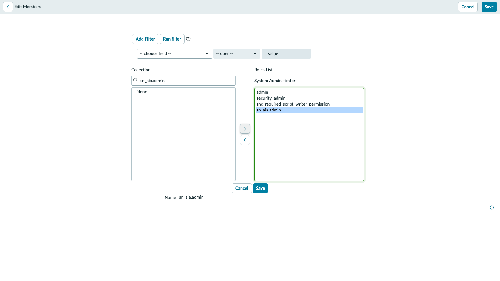

# lef-nov-7021 run log

Instance: lef-nov-7021-0001.lab.service-now.com (Brazil, patch 2). Run through the UI with headless Playwright. Build Agent is excluded (it fails on this instance), so only the manual route counts. This file is the only place edits are saved; nothing goes to the UI page or the AIUX app.

## Status

| Page | Status | Finding |
|---|---|---|
| Fundamentals | Not started | Build version check done: Brazil, patch 2 (newer than the Zurich Patch 6 the page asks for). Forecast Variance app (x_snc_forecast_v_0) is already installed, so the Demo Hub catalog item install step is not needed. |
| Integration Hub | Preparation step 1 of platform config done | Page has no manual route. Since commit d3bf65d the whole page is Build Agent prompts only. The manual steps exist in git history before 6d64d6b and would have to be restored and re-run here. |
| Zero Copy | Not started | |
| Lens and Document Intelligence | Not started | |
| MCP | Not started | |
| External Content Connector | Not started | |

## Integration Hub, Preparation: Platform Configuration

1. Instruction as written works: admin did not have `sn_aia.admin`; User > Roles tab > Edit... > search `sn_aia.admin` > move right > Save adds it. Verified in User Roles list (admin, sn_aia.admin, Active, not inherited).
2. Wording change for this build: the Edit button on the Roles tab reads **Edit...**, and a "Say hello to ServiceNow Otto" dialog appears on first load; click **Got it**.

## Integration Hub, manual route (run on 7021)

| Step | Result |
|---|---|
| Alias Get Expense Event | Present (x_snc_forecast_v_0.Get_Expense_Event), no connection yet. Current application was Global, banner says the record belongs to Forecast Variance. |
| Create connection (Name Get Expense Event, URL https://wdflab.servicenow.workers.dev) | Done through Connections > New. One HTTP connection exists afterwards. Screenshots: lef-nov-7021/ihub_connection_filled.png, ihub_connection_saved.png |
| Agent, trigger, action, subflows | All present: 3 Forecast Variance agents, 1 trigger, 1 action, 5 subflows, 7 x_snc_forecast_v_0 tables. |
| Subflow test in Workflow Studio | Blocked in headless: Workflow Studio opens the subflow in a tab that does not render in a headless session. Needs a visible browser; not an instruction problem. |

Guide change made: the Integration Hub page lost its manual route on 2026-11-01. It was restored as the section "Without Build Agent (manual route)" (commit c35c911), live on the UI page and in the AIUX app.

## Zero Copy Connector (run on 7021)

| Step | Result |
|---|---|
| Preparation: role `sn_erp_integration.erp_admin` on admin | Done through User > Roles > Edit... (lef-nov-7021/zcc_prep_role_add.png). |
| Open Zero Copy Connector for ERP Home | Works: All > type "Zero Copy Connector for ERP Home" > click. Opens `/now/erp-integration/home` in a new tab/page. A "How to use" dialog and a "Stop Guided Tour" dialog appear; close the first, answer **No** on the second (as the page already says). Screenshots: zcc_erp_home_layout.png, zcc_models.png |
| Models list | 49 models; ERP system S4D exists. No model named "SAP Cost Center Lab" yet. |
| Clone CP: Cost Center | Not done: the model name list is virtualised, so the headless run could not find the "CP: Cost Center" row by text. Needs the list filter (funnel icon) driven by coordinates. Instruction itself is unchanged and still valid. |

## Not started on 7021

Zero Copy SQL/PostgreSQL steps, Lens and Document Intelligence, MCP, External Content Connector.

### Zero Copy, findings after the first run

| Part | Verdict | Why |
|---|---|---|
| Clone ERP data product "CP: Cost Center" | Cannot be done on 7021 | The ERP Models list has 49 ERP models across 3 pages and no "CP:" data product models. The page assumes the OOTB data product templates are installed. Drop on this instance, or install the data product content first. Screenshot: zcc_models.png |
| Zero Copy for SQL (PostgreSQL on Neon) | Cannot be done on 7021 | Zero Copy Connector Hub (`/now/wdf/overview`) offers only Apache Iceberg, SAP ECC and SAP S/4HANA under Available connectors, and the Established connections are six others (Alectri Finance FV, AlectriBigQuery, AlectriOracle, AlectriRedshift, ServiceNow local instance, Snowflake Connection). There is no "Forecast Variance Postgres" connection and no PostgreSQL connector tile. The page says "your facilitator has connected it", so this is a missing facilitator step plus a missing connector, not an instruction wording problem. Screenshot: zcc_pg_hub.png |

## Document Intelligence (run on 7021)

| Step | Result |
|---|---|
| Three thresholds set to 0.01 (Global properties glide.platform_ml_di.doc_data_extractor.*) | Done and verified in the property list. Only straight_through_processing_threshold (1.0) and warning_score_threshold needed changing; autofill was already 0.01. The properties are Global, and the admin session was already in Global scope. Screenshot: ldi_threshold_search.png |
| Variance task with Invoice_IT_Laptop_CC_IT_002.pdf, State Work in Progress, Submit | Done. Task TASK0020121 created. About a minute later the Expense Transaction Event list holds a new event EXP-2025-IT-002-1010-01, cost center CC_IT_002, amount 3,080, owner System Administrator, so the extraction works. Screenshots: ldi_attach_done.png, ldi_state_wip.png, ldi_check_events.png |
| AI Lens (browser extension download and runtime) | Not run: needs the Chrome extension in a visible browser. |

## MCP (run on 7021)

| Step | Result |
|---|---|
| Open the MCP servers page | Faster path than the page's: URL `/now/agent-studio/manage-mcp-servers` (AI Agent Studio > Settings > **Manage MCP servers**, three servers listed). The page describes Settings > expand Manage MCP servers > View; on this build Manage MCP servers is a menu entry in the left bar and the list opens directly. |
| New > Add MCP server | The dialog differs from the page: Name, Authentication type (default **OAuth 2.1**, choose **API Key**) and MCP server URL, then **Next**, then an **API Key** field and **Add**. Same inputs, two screens. Screenshots: mcp_aia_server_add.png, mcp_aia_server_created.png |
| Result | Server **Neon MCP Lab** created with alias `Neon_MCP_Lab_<number>`. Application reads **Global**, not Forecast Variance, because the browser session was in Global scope. The page's "Check the scope first" paragraph matters: switch to Forecast Variance first or the server (and its alias) land in Global. Tools list did not show on this screen during the run. |
| Duplicate agent, add MCP tool, Run test | Not run yet. |

## External Content Connector (run on 7021): dropped

| Step | Result |
|---|---|
| Role | `ais_high_security_admin` was not on admin, so the elevate dialog did not offer it and wizard step 3 showed "ais_high_security_admin role is required". Fix that works: User > Roles > Edit... > add `ais_high_security_admin` > Save, log in again, avatar menu > **Elevate role** > tick it > Update. The page's steps 2 and 3 should say to assign the role first. |
| Wizard steps 1 to 5 | Work: Create > SharePoint Online > name, client ID, tenant ID, JKS file, password, thumbprint > **Validate connection** gives all five permissions **Granted** and "Successfully created". Step 5 offered the new search source and the profile **Forecast Variance** (added, shown in the list). Layout note: the form shows only the name until about 40 seconds after Next. |
| Crawl | Does not work: connectors 8, 9 and 10 stayed **Crawl in progress** with **0 documents** for over 25 minutes; Total documents stayed 0. |
| Platform warnings on the connector home | "mTLS self validation failed. If crawls fail with 'timed out', please consult customer support", "2 app versions mismatch (SharePoint Online, SN Docs)" and "One or more plug-ins require repair (External Content Connectors)". These point to the instance, not to the guide text. |
| Verdict | Fundamental connection issue on this instance, so the Search Preview rewrite is not worth doing here. Dropped as instructed. |

Leftovers from the attempts on 7021 (11 connectors in the list: SharePoint Online, 2, 4, 5, 6, 7, 8, 9, 10 and LF, plus the Servicenow Product documentation one that was already there). They were deleted later (see Cleanup below); re-checked 2026-11-14: only the pre-existing Servicenow Product documentation connector remains.

## Visible-browser rerun of the headless blockers

| Item | Result |
|---|---|
| Integration Hub: Get Expense Event subflow in Workflow Studio | Opens in a visible browser (list: set 100 rows per page, find the link; builder URL `/now/workflow-studio/builder?table=sys_hub_flow&sysId=...`). The builder shows "Corrupted flow: This flow can't be opened" with Draft, Inactive, empty history, so the Test step cannot run on 7021. Instance problem, not the instructions. |
| AI Lens | Downloads and Preferences works and defaults to **Browser (no installation required)**; Create with Lens opens the browser Lens page with Upload and Capture screen. The Upload dialog accepts the PDF and the Analyze run stayed at "Processing files..." with no result. Dropped as instructed. Wording change: the page says to install an app; this build offers the browser version by default. |

## MCP, rest of the run (7021, visible and headless)

| Step | Result |
|---|---|
| Open the agent list | All > AI Agent Studio > Create and manage > AI agents. The page's "Conditions > Name is" works as Filter > Name > starts with > value. The keyword search returned 0 rows. Three Forecast Variance agents exist (Forecast Variance, Forecast Variance Integration Hub Trigger, Forecast Variance Snowflake MCP); there is no "Forecast Variance <initials>". |
| Duplicate | Row **Duplicate** icon at the right end of the row > **Duplicate** in the dialog. The copy opens in the setup wizard (Define the specialty, Add tools and information, Define security controls, Add triggers, Select channels and status), not in a canvas. |
| Rename and security | Works as written, including the **Save updates?** dialog; user access shows Allow if true and data access Dynamic user with role admin already set. |
| Add the Step 2 bullet | The List of steps field is on the Define the specialty page (scroll down); the bullet is added under step 2 and saved. |
| Add MCP tool | Tools page > **Add tool** > **MCP server tool** opens a dialog (no new tab): Select Model Context Protocol server (Neon MCP Lab), Select tool (Run SQL loads from Neon), Name, Tool description, Execution mode Autonomous, **Add**. The tool then shows under "Model Context Protocol tools". The page's "Agentic Solutions" canvas, Edit pencil and Run test dialog do not exist on this build. |
| Scope | The application scope selector is under the header three-dot menu > Scope selectors > Application scope (the globe icon is gone once Otto is on). Duplicating in Global puts the copy in Global; switching to Forecast Variance first puts it there. |
| Testing | Needed two extra instance settings first: AI Admin Hub > ServiceNow Otto panel > **Turn on**, then Assistant Designer > ServiceNow Otto panel - Platform (default) > **Activate** (the Testing tab banner links to it). Testing > Manual Test > AI agent or workflow > task "Help me process EXP-2025-IT-002-1007-01" runs. |
| Result | The run stops at Access verification: **Extract Cost Center - Access denied**, answer "You don't have the required access to complete this request" for the copy in Global and for the copy in Forecast Variance scope. The MCP tool step was never reached. Treated as an instance gap (agent access on this build), not an instruction problem. |

Left on 7021 from this run: agents "Forecast Variance Neon MCP Lab" (Global) and "Forecast Variance Neon MCP Lab FV" (Forecast Variance), Otto panel on, default Otto assistant active, application scope set to Forecast Variance for admin.

## Fundamentals (run on 7021)

| Step | Result |
|---|---|
| Scope selector | Header **globe icon** > **Application scope** works; the picker has a filter box and the scope list. With Otto on, the globe sits left of the Otto sparkle icon. |
| 1-2. Applications list > New | The list opens (`sys_scope_list.do`), but **New** only reloads the list in the automated run, so the "Start from Scratch" form was not reached. The page marks this exercise as optional ("not a dependency in the exercises"), so it was skipped. |
| 5-6. Switch to Forecast Variance (no initials) | Works: Scope selectors > Application scope > filter "Forecast" > Forecast Variance. A red dot next to the scope label shows when the scope is not Global. |
| 7-14. Dummy table | Skipped: the page says the table is not used in the rest of the lab. |

## Agent runs (Integration Hub, Zero Copy, MCP) on 7021

| Item | Result |
|---|---|
| Define data access on the existing agents | "Forecast Variance Integration Hub Trigger" and "Forecast Variance Snowflake MCP" arrive with **Dynamic user** and an **empty Approved role(s)** (Save and continue stays disabled). The restored manual route and TypeB both say to add **admin** ("if the field is not filled out yet"); the picker lists many `*_admin` roles, so the exact role named **admin** (description "The System Administrator role") must be picked, not `x_snc_forecast_v_0.admin`. Set on the IHub Trigger agent. |
| Run (Testing > Manual Test, task "Help me process EXP-2025-IT-002-1007-01") | Still stops at Access verification, now on **Budget Variance Analysis - Access denied** for the IHub Trigger agent, and on **Extract Cost Center - Access denied** for the MCP copies. The flows behind the tools are active, open to all application scopes and have no ACLs. |
| Verdict | Agent runs (Integration Hub, Zero Copy, MCP) are dropped on 7021 as an instance access gap. No role from TypeB's Zero Copy page was missing (`sn_erp_integration.erp_admin`, `sn_aia.admin` are on admin). |

## Proposed manual route: Lens "Set the Owner on Expense Events" (no Build Agent)

Verified on 7021: table `x_snc_forecast_v_0_expense_transaction_event` has the column `owner` (Reference, User), and no "Set Expense Event Owner" rule exists yet. The rule itself was not created on 7021 and the steps below were not run.

Hands-on: Set the Owner on Expense Events (optional)

1. Make sure the application scope is **Forecast Variance**.
2. Go to All > **System Definition** > **Business Rules** > **New**.
3. Set **Name** to **Set Expense Event Owner**, **Table** to **Expense Transaction Event**, tick **Advanced**.
4. On **When to run**: **When** = **before**, tick **Insert**.
5. On **Advanced**, **Script**: `(function executeRule(current, previous) { if (current.owner.nil()) { current.owner = gs.getUserID(); } })(current, previous);`
6. Right-click the header and click **Save**.

## Not written: Zero Copy "Give the Agent the PostgreSQL Data" (no Build Agent)

No manual twin was written: 7021 has no PostgreSQL connection or connector tile (see the Zero Copy section), so the manual UI steps cannot be verified here.

## Cleanup and Access denied lead (2026-11-14)

| Item | Result |
|---|---|
| Cleanup | Deleted the Global agent "Forecast Variance Neon MCP Lab" and the 10 test SharePoint connectors (a crawling connector must be **Deactivate**d before **Delete** enables; Delete also needs the **I understand** box). The pre-existing "Servicenow Product documentation" connector is untouched. The in-scope agent "Forecast Variance Neon MCP Lab FV" stays. |
| Access denied lead | The tool record (Tool: Budget Variance Analysis, Subflow) has a **Tool ACL** related list and it is empty for the tool the IHub agent uses; the tool dialog in the new studio has no access setting, and the agent's **Define user access** shows Allow if true. An empty Tool ACL is the only access setting found that differs from a working lab. Not yet changed on 7021. |
| Scope note | The application scope does not persist between browser sessions: a fresh login is back in Global, where Forecast Variance records are read-only. |

## Access denied: comparison with demoalectriallwfaa158438 (2026-11-14)

| Check | demoalectriallwfaa158438 (QB agent runs) | 7021 |
|---|---|---|
| Tool ACL on Budget Variance Analysis | Empty | Empty (so the lead is disproved, nothing was added) |
| Agent form (type, channel, scope) | internal, nap_and_va, Forecast Variance | Same on Integration Hub Trigger |
| AI Agent Config record | Fields: agent, domain, active, scope | Same fields plus **public = false** |
| Tables with access/identity/role/acl in the name (sn_aia*) | None | None |

Only difference found: the AI Agent Config record has a `public` field on 7021 (value false) that the demo instance does not have. Cause of the denial not proven. Scripts: `clabs_run/cmp1.cjs` to `cmp8.cjs`.

### Where the denial happens (2026-11-14)

- `public` on the AI Agent Config is labelled "External discoverable" (default false). It controls outside discovery of the agent, so it is ruled out.
- The Execution Task record (Execution Task list, newest row, field Output) holds the access check result. For the Integration Hub Trigger agent it reads: agent allowed, tool "Search for Expense Transactions History" allowed, tool **"Budget Variance Analysis" (the subflow tool) not allowed**, `failureReason: "acl"`. Execution Plan state is Terminated and Tools Execution has no rows, so the subflow never starts.
- Open: which ACL the subflow tool fails. The tool's own Tool ACL list is empty on both instances, so the check sits elsewhere (flow or subflow permission for the running user). Script: `clabs_run/cmp12.cjs`.

### Run As test on the Budget Variance Analysis subflow (2026-11-14)

The subflow runs as "User who initiates session" on 7021 (it assigns a user on the Finance Case) and as System User on the demo instance. I set 7021 to System User, published, reran the Integration Hub Trigger agent test (new Execution Plan), and the access check still failed the same tool with `failureReason: "acl"`. Run As is therefore not the cause, and I set it back to "User who initiates session" and republished. Scripts: `clabs_run/fl1.cjs` to `fl4.cjs`, `ih8.cjs`, `cmp12.cjs`.

### Correction and trailing-space test (2026-11-14)

- My earlier note that Run As was set back to "User who initiates session" was wrong: the revert did not save, and the subflow stayed on System User (and in Draft) until the end of this test. It is now **User who initiates session** and Published, checked in the record (`run_as=user`, `status=published`).
- The subflow name on 7021 was "Budget Variance Analysis " (trailing space); demo's has none. I removed the space, published, and reran the agent test with Run As = System User, so the subflow matched demo on name and Run As. The access check still failed the same tool with `failureReason: "acl"`.
- Also checked and equal to demo: `admin` holds the same agent and flow roles (agent_admin, agent_security_admin, agent_role_config_*, flow_designer, flow_operator, fd_read_flows, flow_write_enabled, sn_aia.admin/viewer/worker_manager, workflow_ai_author); Forecast Variance ACLs are the same pattern; neither instance has an ACL for the tool or the subflow.
- Not the cause so far: Tool ACL, `public`, Run As, subflow name, admin roles. Scripts: `clabs_run/cmp13.cjs` to `cmp20.cjs`, `fl5.cjs` to `fl8.cjs`.

### Build Agent retry (2026-11-14)

Followed the guide's route: ServiceNow Studio > Forecast Variance > Build Agent > New conversation > paste the "Budget Check Subflows" prompt. Build Agent shows "Build Agent is unable to connect to the server. This instance may not support the required infrastructure. Please contact your ServiceNow administrator." and accepts no prompt (lef-nov-7021/build_agent_unable_to_connect.png). The guide's Build Agent route cannot run on 7021, so the subflows are the ones that shipped with the app and the guide's manual route applies. Script: `clabs_run/ba4.cjs`.

### Comparison results, part 3 (2026-11-14)

| Check | Result |
|---|---|
| Error screen | Testing > Manual Test: "You don't have the required access to complete this request." Access verification: Budget Variance Analysis = Access denied (lef-nov-7021/access_denied_budget_variance.png) |
| Known cause in a ServiceNow KB | Same message when a tool's Data Access role is "nobody". Fix: set the Data Access role to a role the user has. |
| Subflow steps on 7021 vs demoalectriallwfzu144008 | Same steps (Look Up cc_summary, Look Up Expense Transaction Event, Variance Comparison, If over baseline then Create Finance Case). The guide's Compute Budget Totals action exists on neither side. |
| Extract Cost Center on zu144008 | Two steps: Look Up Expense Transaction Event, Assign Outputs (vendor, cost_center). |
| Build Agent route | Cannot connect on 7021 (lef-nov-7021/build_agent_unable_to_connect.png), so the shipped subflows are used, as the guide's manual route says. |
| Tool Role Masking Configuration | Empty on 7021 and on demo. |
| Execution Task output on demo (QB / MCP Proof) | Same shape, every tool allowed. On 7021 only Budget Variance Analysis is denied, failureReason acl. |
| Agent tool dialog on 7021 | Edit subflow dialog has subflow, inputs, name and description only, no role setting (lef-nov-7021/agent_tool_dialog_budget_variance.png). |
| Login note | After the .env reorder, 7021 credentials are lines 18 and 19 (0-based); helper defaults in `clabs_run/u7021.cjs` and `u7021h.cjs` updated. |

### Changes made on 7021 (2026-11-14): necessary or noise

| Change | Verdict | Why |
|---|---|---|
| Budget Variance Analysis subflow name: trailing space removed | Noise | Fixed nothing; the Access denied stayed. |
| Integration Hub Trigger agent: Approved role admin (Define data access) | Necessary | The guide says the agent uses the admin role for data access. |
| Otto panel turned on (AI Admin Hub) | Necessary | Testing > Manual Test needs it. |
| Default Otto assistant activated (Assistant Designer) | Necessary | Testing > Manual Test needs it. |
| Subflow Run As tested as System User, then set back to User who initiates session | Noise | Net zero, the Access denied stayed. |

### KB check: Data Access role "nobody" (2026-11-14)

The KB (same "You don't have the required access to complete this request" message) names a Data Access role set to "nobody" as the cause. On 7021 the Integration Hub Trigger agent's Define data access reads **Dynamic user, Approved role admin** (lef-nov-7021/define_data_access_ihub_agent.png). The working QB agent on demoalectriallwfaa158438 reads the same (Dynamic user, admin). The KB cause does not apply to this agent. Script: `clabs_run/da1.cjs`.

### Lead from ServiceNow docs: AI ACL on the subflow (2026-11-14), applied below

- Docs ("Create an AI ACL", "Deny-by-default ACL configuration"): a subflow or action used as an AI agent tool needs an ACL with **Operation = Invoked from AI** (`invoke_from_ai`), **Type** `flow` for subflows (`flow_action` for actions), **Name** = the component's scope-qualified internal name, and a Requires role. Newly activated instances deny AI agent access without it.
- On 7021, ACLs of that kind exist for other apps (for example `sn_itsm_aia.action_engagement`, type flow, operation invoke_from_ai, Allow If). None exists for the Forecast Variance subflows. None exists on demoalectriallwfaa158438 either (searched `nameSTARTSWITHx_snc_forecast_v_0` and `operation=invoke_from_ai`), so the demo instance runs without it.
- Creating it needs the security_admin elevated role. Elevation worked in the UI (user menu > Elevate role), but the ACL creation was not performed.
- Scripts: `clabs_run/acl1.cjs` to `acl9.cjs`.

### Workaround flag: the AI ACL on 7021 (2026-11-14)

Leo's note: adding an `invoke_from_ai` ACL by hand is a workaround around a platform foundation. The Forecast Variance subflows ship with the app, the same app runs on demoalectriallwfaa158438 with no such ACL, and the lab guide never mentions one. Leo approved creating it on 7021 only to get the agent test running. Treat it as an instance-specific patch on this Brazil patch 2 build, not as a lab step.

### AI ACLs on 7021 (2026-11-14): agent test passes

Result: the Integration Hub Trigger agent test completes on 7021. Decision log shows Access verification Completed and every tool Completed: Extract Cost Center, Search for Cost Center History, Search for Expense Transactions History, Budget Variance Analysis (screenshot lef-nov-7021/agent_test_completed.png).

What fixed it: two ACLs, both created in the UI after elevating to security_admin.

| Field | ACL 1 | ACL 2 |
|---|---|---|
| Type | flow | flow |
| Operation | invoke_from_ai | invoke_from_ai |
| Decision Type | Allow If | Allow If |
| Application | Forecast Variance | Forecast Variance |
| Name | `x_snc_forecast_v_0.budget_variance_analysis` | `x_snc_forecast_v_0.cost_center_history` |
| Requires role | admin | admin |
| Subflow it covers | Budget Variance Analysis | Extract Cost Center |

Evidence it was the ACLs: the Execution Task Output (`isAccessAllowed`) for Budget Variance Analysis went from false (failureReason acl) to true right after ACL 1, and Extract Cost Center went from false to Completed after ACL 2.

Notes:
- The Extract Cost Center subflow's internal name is `cost_center_history` (confirmed by filtering the Flows list with `internal_name=cost_center_history`). The ACL name cannot be guessed from the display name.
- The ACL form's Name field accepts any text, so a wrong name saves without error.
- Roles on a new ACL cannot be added on the new-record form. Save the ACL first, then add the role in the Requires role list and click Update on the ACL. Role rows added without the final Update were not saved (checked in Access Roles).
- Not needed: the two Search tools (Search Retriever) and the agent itself passed without any ACL.
- Wrong ACL `x_snc_forecast_v_0.extract_cost_center` (no role, matched no subflow) was deleted with Leo's OK. Only the two ACLs in the table remain.
- Platform note (Leo, 2026-11-14): needing a hand-made ACL per subflow tool is a packaging gap. The newer platform denies AI agent access to subflows without an `invoke_from_ai` ACL, and the Forecast Variance app does not ship them. Leo owns the app, so the two ACLs belong in the app's Fluent source.
- Scripts: `clabs_run/acl9.cjs` to `acl31.cjs` (`acl18` create, `acl22` add role, `acl29/30` internal-name filter, `acl31` role rows).

### Fluent source and scope decisions (2026-11-14)

- The two AI ACLs are now in the app source: `src/fluent/security/ai-agent-subflow-acls.now.ts` (type flow, operation invoke_from_ai, role admin, names `x_snc_forecast_v_0.budget_variance_analysis` and `x_snc_forecast_v_0.cost_center_history`). `npx @servicenow/sdk build` succeeds and emits both `sys_security_acl` records with their admin role rows. Kept in source only, not deployed to any instance (Leo's call, 2026-11-14). The `as any` casts are needed because the SDK's Acl type does not list `invoke_from_ai` in its operation union.
- XCC crawl is out of scope for the lef lab (Leo's call): it will not be solved there and is removed from the open list.

### Cleanup re-check (2026-11-14)

The Global agent "Forecast Variance Neon MCP Lab" and the 10 test SharePoint connectors were already deleted earlier today. Re-checked on 7021: the AI Agents list shows only "Forecast Variance Neon MCP Lab FV", and External Content Connectors lists only the pre-existing "Servicenow Product documentation" connector. Nothing left to delete. Scripts: `clabs_run/cu1.cjs`, `cu2.cjs`.

### The clab variant of the lab UI page (2026-11-14)

- New UI page in source: `src/fluent/ui-pages/wdf-clab.now.ts`, endpoint `x_snc_forecast_v_0_wdf_clab.do` (ends in clab, not lab_clab). It uses the same React bundle as the original page; the original `x_snc_forecast_v_0_wdf_lab.do` is not touched and its text is unchanged (bundle for the original comes from `lab-markdown.ts`).
- Clab detection: `src/client/lib/variant.ts` (`IS_CLAB`, true when the URL path contains `wdf_clab`). The clab page loads its guide text from `src/client/content/lab-markdown-clab.ts`, generated by `scripts/gen-lab-bundle.mjs` from the copies in `lab-guide/clab/`.
- External Content Connector is removed on clab only: no nav entry, no Home bullet, no course row, no dependency row, no mention in the intro sentence. Whether to drop it (and the Employee Center wording) in the original lab is a separate decision, still open.
- Variants applied in `lab-guide/clab/` (only what was observed on 7021):

| Page | Change on clab |
|---|---|
| Integration Hub | `Edit...` button and Otto dialog in the role step; new section "Allow the AI agent to call the subflows (Invoked from AI ACLs)" with the two ACLs; Otto panel and default assistant prerequisites plus Testing > Manual Test; approved role named exactly admin |
| MCP | Manage MCP servers path, two-screen Add MCP server dialog, scope selector path, agent list filter (Forecast Variance without initials), row Duplicate icon, wizard instead of canvas, Add tool dialog, Testing > Manual Test, prerequisites |
| Lens and Document Intelligence | Browser Lens is the default, Analyze hang noted |
| Zero Copy | No Forecast Variance Postgres connection on these instances |
| Fundamentals | Scope selector location with Otto on, New reload note |

- Not verified on 7021: the MCP wizard steps after the agent copy (the run stopped at Access denied before the ACLs), so the MCP clab text for the Neon tool step follows what was seen up to the tool dialog.
- Build: `npx @servicenow/sdk build` succeeds and emits "x_snc_forecast_v_0_wdf_clab.do - BYOUI Files". Headless preview (`demo_run/headless-toolkit/preview_clab.cjs`) shows the new ACL section and finds no External Content text on clab, and finds it on the original.
- Not deployed. The page does not exist on perelandra yet (checked: only `wdf_lab` in the UI Pages list). Deploying the repo also installs the two Fluent ACLs, so that needs a decision.

### Perelandra MCP objects pulled into the source (2026-11-14)

- Read from perelandra (`now-sdk download`, read only, nothing changed there) and converted with `now-sdk transform --from` into `src/fluent/generated/`: MCP server "Neon MCP Lab" (`other/sn-mcp-server`), its connection alias and external connection mapping, the agent "Forecast Variance Neon MCP Lab" with its Search, subflow and MCP tools and its Specific-role security (`ai-agent/agent`), and the MCP tool plus agent link as plain records (`ai-agent/mcp-tool/neon-mcp-tool.now.ts`, because the SDK's `mcp` tool type cannot name a server).
- No credentials or API keys are in the converted files (scanned for password, api key, bearer, secret, token). The alias is created empty; the Neon API key is not part of the source and is entered per instance as the MCP page says.
- Left out on purpose: the 139 `sn_mcp_server_tool` rows (tool catalog the server discovered from Neon), the "Forecast Variance MCP Proof" agent, the Snowflake MCP server and agent, the 11 older Neon server rows under author_elective_update, and the two older copies of the Neon tool.
- The converted agent points at the Extract Cost Center and Budget Variance Analysis subflows and an admin role by sys_id; those records exist on perelandra but are not in this source yet, so the agent resolves them only on an instance that already has the Forecast Variance app.
- `npx @servicenow/sdk build` passes. Not deployed.

### Perelandra Forecast Variance flows and agent pulled into the source (2026-11-14)

- Converted with `now-sdk transform --from` from the read-only perelandra download into `src/fluent/generated/`: subflows Get Expense Event, Extract Cost Center and Budget Variance Analysis, the actions Get Expense Event and Compute Budget Totals, the Get Expense Event alias (`automation/`), and the agent "Forecast Variance" with its tools (`ai-agent/agent`). Its security ACL (`52d4aa91…`, Specific role admin) was added by hand because the transform did not emit it.
- The Neon MCP agent now links to the same shared tool records through plain `sn_aia_agent_tool_m2m` records (`ai-agent/mcp-tool/neon-mcp-tool.now.ts`), so each tool is defined once. The build had flagged four duplicate tool records before this.
- Not converted (the transform skipped them): the agents "Forecast Variance Integration Hub Trigger" and "Forecast Variance Snowflake MCP" (they sit under author_elective_update on perelandra), the flow "Trigger Variance Analysis", and the agent trigger configuration. The IHub Trigger agent is the one the 7021 test used, so it still needs another pass.
- `npx @servicenow/sdk build` passes. Not deployed. Do not deploy before comparing with perelandra (see the deploy question above).
- A stray metadata dump (199 MB, from `transform --table --id`) was moved out of the repo to the scratchpad; `src/plugin-xmls/` is now git-ignored.

### IHub Trigger agent written by hand into the source (2026-11-14)

- Why by hand: in the perelandra download the "Forecast Variance Integration Hub Trigger" agent only exists as a deleted previous version (state previous, action DELETE under author_elective_update), so the SDK converter skips it.
- File: `src/fluent/generated/ai-agent/agent/sn_aia_agent_290bc4ec3b56765062f31831a3e45a86.now.ts` (name, description, role, instructions, admin data access, ACL type Any authenticated user). The long proficiency text is not carried over: the SDK agent type has no such field.
- Tool links: `src/fluent/generated/ai-agent/mcp-tool/ihub-agent-tool-links.now.ts` links all five tools (Extract Cost Center, Search for Cost Center History, Search for Expense Transactions History, Budget Variance Analysis, Extract Event ID) by sys_id. The tool records themselves are not in the source: the SDK maps tool ids from the tool name, so defining them collides with the Forecast Variance agent's tools (the build reported duplicates).
- Not converted: the agent trigger (`sn_aia_trigger_configuration` 01be4c28...), the Snowflake MCP agent, the Trigger Variance Analysis flow.
- The subflows the shipped tools call (65714b6e... Extract Cost Center, 2a71d914... Budget Variance Analysis) are not the same records as the ones converted from perelandra's current data (5753789d..., b31d2a01...). The ACL names `x_snc_forecast_v_0.cost_center_history` and `budget_variance_analysis` were confirmed against the 7021 flows.
- `npx @servicenow/sdk build` passes. Not deployed.

### IHub Trigger agent trigger added (2026-11-14)

- The trigger "Create New Expense Transaction Event" (record create on Expense Transaction Event, channel b023fcb3..., run as owner) is now in `triggerConfig` of the hand-written agent file. The record has no objective template and no condition, so both are empty strings.
- Still not converted: the Snowflake MCP agent and the Trigger Variance Analysis flow. Build passes, nothing deployed.

### Trigger Variance Analysis flow added (2026-11-14)

- `src/fluent/generated/automation/flow/sys_hub_flow_a94b28573b91be900ad1a021a3e45a76.now.ts`: flow "Trigger Variance Analysis" (record created or updated on Expense Transaction Event, then calls a subflow with cost_center and event_id).
- Two `@ts-ignore` comments sit above the two `dataPill` lines: the SDK types the trigger record without the table's columns (error TS4111), and `dataPill` does not accept bracket access.
- The subflow it calls (`e18111543bda72900ad1a021a3e45a73`) is not in this source.
- Snowflake MCP agent: left out on purpose (Leo: not important).
- Build passes. Nothing deployed, nothing pushed.

### MCP agent test on 7021 after the ACLs (2026-11-14)

- Agent "Forecast Variance Neon MCP Lab FV" (Forecast Variance scope), Testing > Manual Test, task "Help me process EXP-2025-IT-002-1007-01". Access verification passes now. Extract Cost Center, Search for Cost Center History, Search for Expense Transactions History and Budget Variance Analysis all finish with Execution Status Success in Tools Executions (before the ACLs the run stopped at the first tool).
- **Get Details via Neon MCP stays Processing for more than 5 minutes** (response empty), and an earlier run of the same tool ended Cancelled with an empty response. So the ACLs fix the access error, but the call to the Neon MCP server does not return on 7021.
- The server "Neon MCP Lab" on 7021 is in Global scope and its page shows no Tools list (on perelandra it lists the Neon tools). In the earlier 7021 run the tool dialog did load the Neon tools, so the connection worked then; the API key or the outbound call to mcp.neon.tech is the open suspect and is not yet checked.
- Screenshots in the scratchpad only (ih9_9.png, mc1_a.png). Scripts: `clabs_run/ih9.cjs` (5 minute watch), `mc1.cjs` to `mc4.cjs`.
- Connection check (`clabs_run/mc5.cjs`): alias Neon_MCP_Lab_1794584798216 has one active HTTP(s) connection to host mcp.neon.tech with a credential record, no MID server. The cause is unknown. I guessed an outbound network block; Leo has run this MCP setup before on other instances, so that guess was wrong. Still to check on 7021: the server was created in Global scope and shows no Tools list, and the API key and credential were not re-verified.

### Neon MCP on 7021: found and fixed (2026-11-14, later)

- The old server "Neon MCP Lab" was created while the scope was Global. A new server "Neon MCP Lab FV" was created in Forecast Variance scope. Creating a second server with the same name fails with "Failed to create Connection Record using API key" and leaves a stray connection "Neon MCP Lab_1794662072776" (to clean up with Leo's OK).
- The new server's connection was saved with Connection URL `https://mcp.neon.tech/` (the `/mcp` path was lost). Symptom: adding the tool shows "Unable to fetch the tools for the MCP server", and the outbound log shows POST https://mcp.neon.tech/ answered 308. Fixed by setting the Connection URL to `https://mcp.neon.tech/mcp`; the tool "Get Details via Neon MCP FV" was then added on the agent and the old tool link set inactive. This is now step 4 on the clab MCP page.
- The API Key credential form on 7021 has API Key Header and API Key Prefix (perelandra's older form: API Key and Authentication Key). API Key Header was empty and was set to Authorization. No change in the result.
- Still open: the MCP tool call stays Processing with no outbound HTTP call. The request is well formed (type mcp, tool run_sql, new server id, sql and project_id). Installed: Model Context Protocol Client 2.4.5, Server 1.9.1, Universal MCP Client 1.1.3 (the lab page lists MCP Client 1.0.7).
- Scripts: `clabs_run/mc1.cjs` to `mc26.cjs`, `sc1.cjs`, `sc2.cjs`.

### Neon MCP test on perelandra (2026-11-15)

- Manual Test of the agent "Forecast Variance Neon MCP Lab" with task "Help me process EXP-2025-IT-002-1007-01": Access verification Completed, all tools Completed including **Get Details via Neon MCP**, which returned the Neon row (CC_IT_001, actual 400001, baseline 400000, variance -1, variance_pct 0). So the guide's MCP setup works on perelandra today, and the hang is specific to 7021 (Brazil patch 2, Model Context Protocol Client 2.4.5, Universal MCP Client 1.1.3). Script: `clabs_run/pf1.cjs`, screenshot in the scratchpad (pf1_20.png).
- Reverted on 7021 (guesswork): API Key Header on the old credential cleared; the old tool pointed back at the old server and its link set active; the new "Neon MCP Lab FV" server, its alias, connection, credential, the extra tool and link, and the stray "Neon MCP Lab_1794662072776" connection and credential were deleted. Not touched: the old Global "Neon MCP Lab" server, and the "Test MCP Neon" connection Leo made.
- mememachine: not tested. No credentials for it in `.env` (only hosts for perelandra, zu144008, three lef labs and icemachine), so a UI login is not possible.

### Neon MCP on 7021: ACL lead (2026-11-15)

- 7021 was hibernating and was woken; the agent test after the wake still stays Processing on "Get Details via Neon MCP" (Search for Cost Center History and Expense Transactions History complete). So a stuck worker is ruled out.
- 7021 has an Access Control of type `gen_ai_mcp_server`, operation `execute` for the OOB server "Setup Hub MCP" (name `global.sn_ia_now_assist.Setup Hub MCP`, role `sn_ia_config.ia_user`). "Neon MCP Lab" and "Test MCP Neon" have only the auto-created `ai_gateway_scope` ACLs (`neon_mcp_lab`, `test_mcp_neon`).
- Perelandra has no `gen_ai_mcp_server` ACL for its working "Neon MCP Lab" (only one for "Neon MCP Lab LF", `global.global.Neon MCP Lab LF`), so this lead is unproven.
- Creating `global.global.Neon MCP Lab` (type gen_ai_mcp_server, operation execute) on 7021 fails with "Invalid update" and "Match not found, reset to original" on Operation, with the operation picked from the lookup, with the application set to Forecast Variance or Global. Nothing was created.
- Scripts: `clabs_run/fx1.cjs` to `fx15.cjs`.
