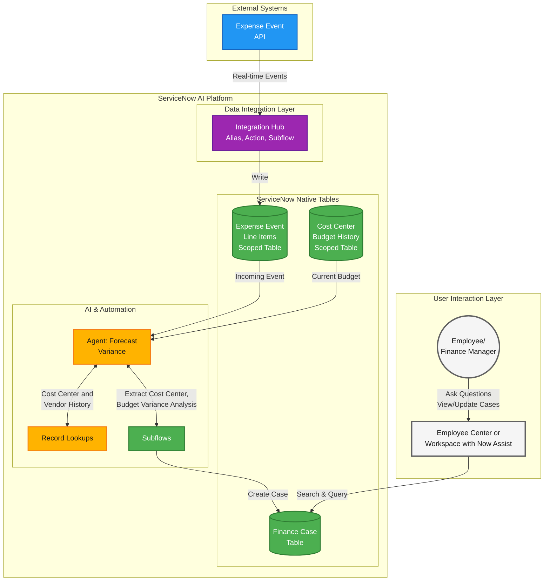
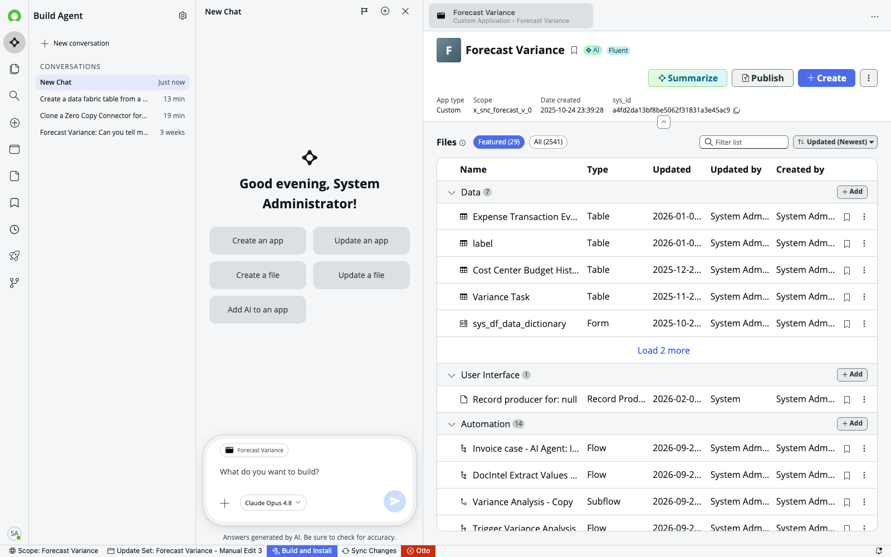
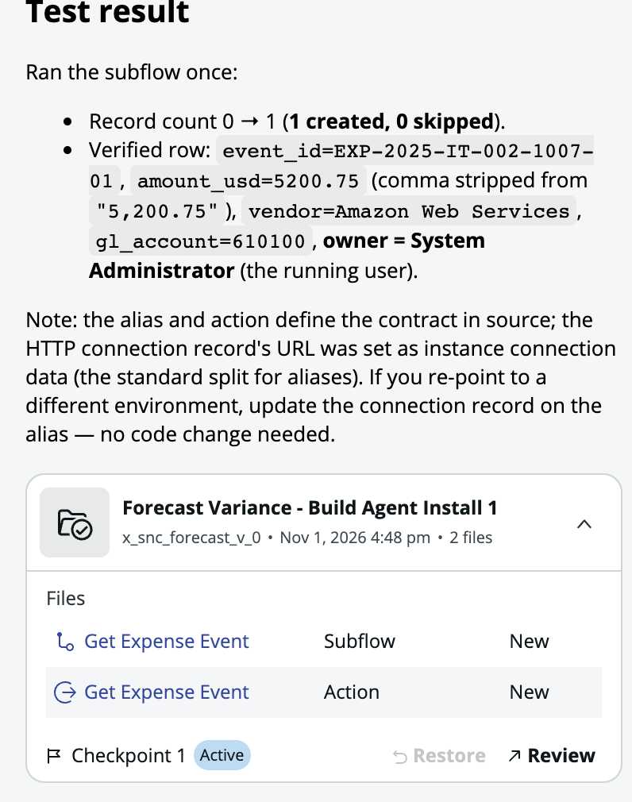
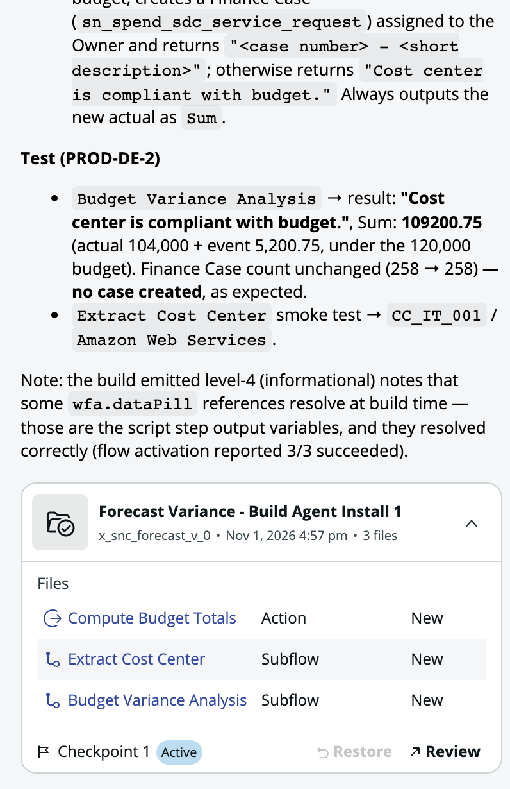

# Lab Exercise: Integration Hub

## Where we are in this workshop

<figure><picture><source srcset="../.gitbook/assets/dataflow_outcome_agent_flow_integration_hub_dark.png" media="(prefers-color-scheme: dark)"></picture><figcaption></figcaption></figure>

> **Legend:** 🟤 Data | 🟣 Workflow Data Fabric | 🔵 External Systems | ↓ Takes data from

## Lab Exercise: Integration Hub

[Take me back to main page](../)

In this lab you use **Build Agent** to build, in the **Forecast Variance** app, the **Action**, **Subflows** and **AI agent** that get expense data from an external REST API, check the cost center against its budget, and create a Finance case when the cost center will be over budget.

The tables and their data are already in the app. You build the logic on top of them with four prompts, then run it and watch the agent react.

<figure><figcaption></figcaption></figure>

<figure><figcaption></figcaption></figure>

### Lab Sections and Objectives

<table><thead><tr><th width="83">Step</th><th width="106">Who</th><th>Description</th></tr></thead><tbody><tr><td><a href="lab-exercise-integration-hub.md#data-flow">1</a></td><td>Facilitator</td><td><strong>Context Setting:</strong> Review the data flow diagram. Understand how ServiceNow consumes a REST API endpoint, writes the events to a scoped table, triggers an AI Agent, and creates a Finance Case automatically.</td></tr></tbody></table>

**Preparation**

<table><thead><tr><th width="83">Step</th><th width="106">Who</th><th>Description</th></tr></thead><tbody><tr><td><a href="lab-exercise-integration-hub.md#preparation-platform-configuration">2</a></td><td>Student</td><td><strong>Platform Configuration:</strong> Set the AI model provider, the scope and the <code>sn_aia.admin</code> role.</td></tr><tr><td><a href="lab-exercise-integration-hub.md#preparation-initial-checks">3</a></td><td>Student</td><td><strong>Initial Check:</strong> Verify the Now Assist panel is accessible.</td></tr></tbody></table>

**Build with Build Agent**

<table><thead><tr><th width="83">Step</th><th width="106">Who</th><th>Description</th></tr></thead><tbody><tr><td><a href="lab-exercise-integration-hub.md#hands-on-expense-event-integration">4</a></td><td>Student</td><td><strong>Expense Event Integration:</strong> Build Agent creates the "Get Expense Event" alias, action and subflow, and tests them.</td></tr><tr><td><a href="lab-exercise-integration-hub.md#hands-on-budget-check-subflows">5</a></td><td>Student</td><td><strong>Budget Check Subflows:</strong> Build Agent creates the "Extract Cost Center" and "Budget Variance Analysis" subflows, and tests them.</td></tr><tr><td><a href="lab-exercise-integration-hub.md#hands-on-forecast-variance-ai-agent">6</a></td><td>Student</td><td><strong>AI Agent:</strong> Build Agent creates the "Forecast Variance" agent with your initials after the name, its four tools and its trigger.</td></tr></tbody></table>

**AI Agent and Finance Operations Workspace**

<table><thead><tr><th width="83">Step</th><th width="106">Who</th><th>Description</th></tr></thead><tbody><tr><td><a href="lab-exercise-integration-hub.md#hands-on-flow-execution">7</a></td><td>Student</td><td><strong>Run the Flow:</strong> Empty the Expense Transaction Event table, then run the "Get Expense Event" subflow.</td></tr><tr><td><a href="lab-exercise-integration-hub.md#walkthrough-agent-runtime">8</a></td><td>Student</td><td><strong>Watch the AI Agent React:</strong> Open Now Assist. Explore the steps the agent ran, the cost center and vendor history, the budget analysis and the Finance Case link.</td></tr><tr><td><a href="lab-exercise-integration-hub.md#completion-verify-finance-case">9</a></td><td>Student</td><td><strong>Verify the Finance Case:</strong> Find the case created by the agent in Finance Operations Workspace.</td></tr></tbody></table>

<table><thead><tr><th width="83">Step</th><th width="106">Who</th><th>Description</th></tr></thead><tbody><tr><td><a href="lab-exercise-integration-hub.md#conclusion">10</a></td><td>Facilitator</td><td><strong>Conclusion:</strong> Walk through the complete data flow chain. An external event triggers proactive financial intelligence with zero human intervention.</td></tr></tbody></table>

### Data flow

The data flow below shows how ServiceNow consumes the REST API endpoint through an Integration Hub connection alias and action. The subflow writes the entries to the scoped table, and each new entry triggers the AI agent, which checks the cost center against Cost Center Budget History.



> **Color Legend:** 🟡 Now Assist | 🟢 Platform | 🟣 Workflow Data Fabric | 🔵 External Systems | ⚪ User Interaction
>
> [📊 View High-Resolution Diagram](https://raw.githubusercontent.com/leojacinto/WorkflowDataFabric-TypeE/main/lab-guide/assets/dataflow_integration_hub.png)

### Preparation

#### Preparation: LLM Configuration

Ensure the **AI model provider** is **Azure OpenAI** to so you have an experience consistent to the environment in which the lab has been built on.&#x20;

1.  Navigate to **All** > <mark style="color:green;">**a.)**</mark> type **AI Admin Hub** > <mark style="color:green;">**b.)**</mark> click on **Settings**.

    <figure><figcaption></figcaption></figure>
2.  Go to <mark style="color:green;">**a.)**</mark> Manage AI models > Manage model providers then <mark style="color:green;">**b.)**</mark> click the **Model providers** tab (takes \~2 minutes to load) and <mark style="color:green;">**c.)**</mark> check whether the **Default model provider** column is <mark style="color:red;">**NOT**</mark> **Azure OpenAI** (e.g. **AWS Claude** or **Now LLM Service**). If it is NOT Azure OpenAI, click <mark style="color:green;">**d.)**</mark> **Edit model provider** (top right); else, skip to section **Preparation: Platform Configuration**. When you click **Edit model provider**, the screen will refresh and change its layout.

    <figure><figcaption></figcaption></figure>
3.  In the drop-down, select <mark style="color:green;">**a.)**</mark> **Azure OpenAI** then click <mark style="color:green;">**b.)**</mark> **Save and Activate**.

    <figure><figcaption></figcaption></figure>
4.  It will take \~3-5 minutes to reassign the services. This will result in the screen below. There might be services which will not be assigned successfully, and this can be ignored (e.g. in screenshot below there are 35 skills that failed reassignment to Azure OpenAI. Click **Okay**.

    <figure><figcaption></figcaption></figure>
5.  Finally the **Model provider** column will show that the assignment is mostly **Azure OpenAI**.

    <figure><figcaption></figcaption></figure>

#### Preparation: Platform Configuration

These are required preparation steps in platform level. These are cross configurations that affect instance behaviour (across applications).

1. As **admin** user, this preparation section includes setting up of the scope, authorisation and Now Assist configurations.
2.  Ensure you are in the correct scope. Click on the <mark style="color:green;">**a.)**</mark> **scope** (globe icon) and <mark style="color:green;">**b.)**</mark> **Forecast Variance**.

    <figure><figcaption></figcaption></figure>
3.  Navigate to **All** > <mark style="color:green;">**a.)**</mark> type **Users and Groups** > <mark style="color:green;">**b.)**</mark> click on **Users and Groups > Users**.

    <figure><figcaption></figcaption></figure>
4.  Search for <mark style="color:green;">**a.)**</mark> **System Administrator** then hit **Return/Enter ↵** > <mark style="color:green;">**b.)**</mark> click on **admin**.

    <figure><figcaption></figcaption></figure>
5.  In the **Roles** tab, click **Edit**.

    <figure><figcaption></figcaption></figure>
6.  Search for <mark style="color:green;">**a.)**</mark> **sn\_aia.admin** > <mark style="color:green;">**b.)**</mark> click on **sn\_aia.admin** > <mark style="color:green;">**c.)**</mark> click on **>** to move the role to the right panel > then <mark style="color:green;">**d.)**</mark> click **Save**. You will notice that there are also roles for integration and viewer purposes which can be assigned for users who will need less privileges.

    <figure><figcaption></figcaption></figure>
7.  Right-click on the top panel and click **Save**.

    <figure><figcaption></figcaption></figure>
8.  <mark style="color:red;">**IMPORTANT**</mark>. Log out and log back in.

    <figure><figcaption></figcaption></figure>

#### Preparation: Initial Checks

Verify the Now Assist panel is accessible.

1.  If you have set up the Now Assist Panel correctly, you should see the Otto/sparkle icon on the top right.

    <figure><figcaption></figcaption></figure>

### Build with Build Agent

> **Using Build Agent:** go to ServiceNow Studio, open the **Forecast Variance** app, click **Build Agent** (diamond icon) > **New conversation**, then paste the prompt. Build Agent shows each script before running it; click **Approve**. If it asks you a question, answer it in the chat. If you see a 401 error, reload the page and send the prompt again. Start a new conversation for each prompt.

<figure><figcaption></figcaption></figure>

#### Hands-on: Expense Event Integration

Build Agent creates the connection to the expense API, the **Action** that reads it, and the **Subflow** that runs the action.

1.  Paste this prompt and send it.

    ```
    In the Forecast Variance app:
    1. Create a connection and credential alias named "Get Expense Event", with an HTTP
    connection to https://wdflab.servicenow.workers.dev.
    2. Create a Flow Designer action named "Get Expense Event" that sends GET
    /api/expense-events through that alias. For each returned event whose Event ID isn't
    already in the Expense Transaction Event table, the action itself creates an Expense
    Transaction Event record, copying each field with the same name and setting Owner to the
    user running it. amount_usd arrives as text with commas, so remove them.
    3. Create a subflow named "Get Expense Event" that only runs that action, as the user who
    starts it.
    Then build and install the app, and test it by running the subflow once.
    ```
2.  Click **Approve** each time Build Agent asks. When it finishes, you should see the **Get Expense Event** alias, action and subflow installed, and the test adding the event **EXP-2025-IT-002-1007-01** to the Expense Transaction Event table. The first run of the action grants itself about ten cross-scope privileges (for example for REST messages, connection aliases and Finance Case); this is expected for a scoped app and needs no action from you.

    <figure><figcaption></figcaption></figure>

#### Hands-on: Budget Check Subflows

Build Agent creates the two subflows the agent uses as tools, plus the **Compute Budget Totals** action that does the budget math. **Budget Variance Analysis** is the deterministic part: it adds the new expense to the cost center's 2025 actual spend and creates a Finance Case when the total is over budget.

1.  In a new conversation, paste this prompt and send it.

    ```
    In the Forecast Variance app:
    1. Create a subflow named "Extract Cost Center" with input Event ID (string). It looks up
    the Expense Transaction Event record with that Event ID and outputs its Cost Center and
    Vendor.
    2. Create a Flow Designer action named "Compute Budget Totals" with inputs Cost Center
    and Event ID (strings). Its script step looks up the Expense Transaction Event with that
    Event ID, totals Monthly Budget and Actual Spend for that cost center in Cost Center
    Budget History for fiscal year 2025 (add the records up one by one, because
    GlideAggregate SUM is wrong on these currency fields), and adds the event's amount_usd
    to the actual. It outputs Over Budget, the new actual, the short description "<cost
    center> is exceeding budget" and the cost center's Owner, declared as a String output
    that holds the owner's sys_id (not a reference field). Keep this code in the action,
    because a subflow's own scripts can't read the subflow's inputs.
    3. Create a subflow named "Budget Variance Analysis" with inputs Cost Center and Event ID
    (strings). It runs Compute Budget Totals. If Over Budget is true, it creates a Finance
    Case (sn_spend_sdc_service_request) with that short description, assigned to the Owner,
    and outputs "<case number> - <short description>". Otherwise it outputs "Cost center is
    compliant with budget." Also output the new actual as Sum.
    Then build and install the app. To test, run Extract Cost Center with event ID
    EXP-2025-IT-002-1007-01, then run Budget Variance Analysis with cost center PROD-DE-2
    and that event ID, so no Finance Case is created.
    ```
2.  Click **Approve** each time Build Agent asks. You should see **Extract Cost Center** return **CC_IT_001** and **Amazon Web Services**, and **Budget Variance Analysis** return **Cost center is compliant with budget.** with a Sum of **109200.75** for PROD-DE-2.

    <figure><figcaption></figcaption></figure>

#### Hands-on: Forecast Variance AI Agent

Build Agent creates the **AI agent**, its tools and the trigger that starts it when a new expense event arrives.

1.  In a new conversation, paste this prompt, replace **\<your initials>** with your initials (for example **LF**) and send it.

    ```
    In the Forecast Variance app, create an AI agent named "Forecast Variance <your initials>"
    that reviews new expense events and opens a Finance Case when a cost center goes over
    budget. Its tools run without asking:
    - the "Extract Cost Center" subflow
    - the "Budget Variance Analysis" subflow
    - "Search for Cost Center History": looks up up to 12 Cost Center Budget History
    records by cost center, ordered by fiscal month, and returns fiscal month, monthly
    budget, actual spend and status
    - "Search for Expense Transactions History": looks up records in the global table
    x_snc_forecast_v_0_expense_transactions by cost center and vendor and returns expense
    date, amount and description
    Instructions:
    1. Run Extract Cost Center with the event ID.
    2. Run Search for Cost Center History with that cost center and say whether the months are
    mostly On Target, Over Budget or Under Budget.
    3. Run Search for Expense Transactions History with the cost center and vendor and say
    whether this vendor has transacted before.
    4. Run Budget Variance Analysis with the cost center and event ID and report its result,
    including the Finance Case number if one was created.
    Only users with the admin role can run it, and it uses the admin role for data access. Add
    a trigger: when an Expense Transaction Event is created and Vendor is not empty, run as
    the user admin (System Administrator), objective "Review expense event ${event_id}",
    channel "Now Assist Panel" (the sys_cs_channel record of that name), trigger on.
    Build and install the app without creating test records. An install doesn't build the
    trigger's flow, so then re-save the trigger configuration with a GlideRecord update in
    global scope (setForceUpdate(true), no field changes) and show the trigger_flow it gets.
    ```
2.  Click **Approve** each time Build Agent asks. You should see the agent with its four tools installed, and a **trigger_flow** named like **Expense Transaction Event - AI Agent: Forecast Variance \<your initials>**. Without that flow the trigger never fires.

#### Walkthrough: What Build Agent Built

Optional. Open the records Build Agent created to see how they fit together.

1. **AI Agent Studio** > **Agentic Solutions** > **AI agents** > **Forecast Variance \<your initials>** ([open the list](/sn_aia_agent_list.do?sysparm_query=nameLIKEForecast%20Variance)), then click the **Edit** pencil on the agent. **Definitions** holds the four instructions, **Tools** lists the two subflows and two record lookups, and **Access rules** shows the admin role. **Triggers** shows the trigger on the Expense Transaction Event table.
2. **Flow Designer** > **Subflows** > **Budget Variance Analysis** ([open the list](/sys_hub_flow_list.do?sysparm_query=name=Budget%20Variance%20Analysis)). The subflow calls the **Compute Budget Totals** action, then creates the Finance Case only when the cost center is over budget.
3. **Flow Designer** > **Actions** > **Get Expense Event** ([open the list](/sys_hub_action_type_definition_list.do?sysparm_query=name=Get%20Expense%20Event)). The script step reads the connection from the **Get Expense Event** alias, calls the API and writes the records.

### Without Build Agent (manual route)

Use this route when Build Agent is not available. It uses the **Get Expense Event** alias, action and subflows and the **Forecast Variance Integration Hub Trigger** agent that come with the Forecast Variance app, so no prompts are needed. Do these sections, then continue with **Walkthrough: Agent Runtime**.

#### Manual: Connection Setup

Navigate to Connection & Credential Aliases. Open the pre-configured "Get Expense Event" alias. Create a new Connection pointing to the REST API endpoint.

1.  Navigate to **All** > <mark style="color:green;">**a.)**</mark> type **Connection & Credential Aliases** then <mark style="color:green;">**b.)**</mark> click **Connections & Credentials > Connection & Credential Aliases**.

    <figure><figcaption></figcaption></figure>
2.  Search for <mark style="color:green;">**a.)**</mark>**&#x20;Get Expense Even**t then <mark style="color:green;">**b.)**</mark> click on **Get Expense Event**. This is a pre-configured alias to reduce the rewiring needed for this lab exercise.

    <figure><figcaption></figcaption></figure>
3.  In the next screen, navigate to **Connections** > **New**. In this alias, we are creating a new connection which will get data from the REST API endpoint and serve as trigger for our AI Agent.

    <figure><figcaption></figcaption></figure>
4.  Provide <mark style="color:green;">**a.)**</mark> **Name** as **Get Expense Event**, <mark style="color:green;">**b.)**</mark>**&#x20;Connection URL** as [**https://wdflab.servicenow.workers.dev**](https://wdflab.servicenow.workers.dev) then <mark style="color:green;">**c.)**</mark> click **Submit**. The structure of the table in [Lab Exercise: Fundamentals](https://servicenow-lf.gitbook.io/the-workflow-data-fabric-loom/lab-exercise-fundamentals) is based on the data coming from this REST API endpoint. The data from this endpoint will be written into the scoped table through a scoped **Action**.

    <figure><figcaption></figcaption></figure>
#### Manual walkthrough: Custom Forecast Variance AI Agent

This is a walk through of how an AI agent equipped with both deterministic and probabilistic capabilities can automate research and validation of cost center history and expenses; as well as creation of Finance Cases should cost centers be above their budget allocations. <mark style="color:red;">**Note:**</mark> this is a custom AI agent pre-configured in the lab instance provided in ServiceNow-led lab sessions; this is not an OOTB agent.

For this section: Open AI Agent Studio > Forecast Variance Integration Hub Trigger. Explore: Define the specialty (plain English instructions), Add tools (Search retrievals + Subflows), Define security controls (Dynamic user + admin role).

1. Navigate to **All** > <mark style="color:green;">**a.)**</mark> type **AI Agent Studio** > <mark style="color:green;">**b.)**</mark> click on **Create and Manage**.

<figure><figcaption></figcaption></figure>

2.  This will go to the list of Agentic workflows and AI agents. Go to **AI agents** tab > <mark style="color:green;">**a.)**</mark> click **Conditions** > <mark style="color:green;">**b.)**</mark> select **Field** as **Name** <mark style="color:green;">**c.)**</mark> **Operator** as **is** and for <mark style="color:green;">**d.)**</mark> Value type **Forecast Variance** **Integration Hub Trigger** and hit **Return/Enter ↵**. Click on the <mark style="color:green;">**e.)**</mark> result.

    <figure><figcaption></figcaption></figure>
3. Click on **Define the specialty**. This shows all the instructions for this AI Agent created in plain English. The **List of steps** describes the sequence, purpose, and nuances of the tools configured, which are shown in the next section. No further action is required in this section.&#x20;

<mark style="color:$warning;">**In case you have issues with Now Assist with Extract Cost Center step later:**</mark> You may need to refine step 1 with instructions along the lines of (and feel free to make adjustments): 1. **When a new entry is created in x\_snc\_forecast\_v\_0\_expense\_transaction\_event, you look up the cost center using "Extract Cost Center" tool. This is done by using the event ID which has a format that starts with EXP, something like EXP-2025-IT-002-1007-01.**

<figure><figcaption></figcaption></figure>

4. Next, click on **Add tools and information**. This is a collection of **Search retrievals** and **Subflows** that are used by the agent. The purpose and sequence of these tools are also described in the section **Define the specialty**. No further action is required in this section but feel free to explore the configurations of each of the tools. Below is a brief description of the tools configured for this agent:

**a.) Extract Event ID:** Gets the event ID from the Expense Transaction Event table (x\_snc\_forecast\_v\_0\_expense\_transaction\_event) from the entry created by the action Get Expense event (via REST).

**b.) Extract Cost Center:** gets the cost center from the expense event that is written into the Expense Transaction Event table (x\_snc\_forecast\_v\_0\_expense\_transaction\_event).

**c.) Search Cost Center History:** a RAG based tool which gets the history of a cost center; i.e., is the cost center frequently exceeding its budget? Output serves as reference for the Finance team without the need pull out data for themselves or opening requests to data teams.

**d.) Search for Expense Transactions History:** a RAG based tools which gets the expenses/invoices from a cost center to provide even more granular detail. Output serves as reference for the Finance team without the need pull out data for themselves or opening requests to data teams.

**e). Budget Variance Analysis:** a deterministic flow that assesses whether the latest expense event caused the relevant cost center to be over-budget; if over-budget, creates a Finance Case.

<figure><figcaption></figcaption></figure>

5. Under **Define security controls** > <mark style="color:green;">**a.)**</mark> click **Define data access** > <mark style="color:green;">**b.)**</mark> select **Dynamic user** from the drop down then > <mark style="color:green;">**c.)**</mark> add **admin** user as the **Approved role** if the field is not filled out yet. For this exercise we are using permissive authorisations but this is where you can tighten authorisations for your agents allowing mechanisms such as inheriting the authorisations of logged in user (Dynamic identity type) or a predefined set of access (AI User identity type).

<figure><figcaption></figcaption></figure>
#### Manual: Configure AI Agent Trigger

Delete any existing trigger. Create new trigger: Table = Expense Transaction Event, Field = Vendor, Condition = is not empty. Toggle trigger ON. Save.

1. Next, click on **Define trigger**, which is a key part of this exercise.

<figure><figcaption></figcaption></figure>

2. <mark style="color:red;">**\[IMPORTANT STEP]**</mark> Due to a bug related to the update set for this lab, if there is an existing trigger, you will need to delete that and **re-create**. Click the <mark style="color:green;">**a.)**</mark> **delete** icon then <mark style="color:green;">**b.)**</mark> click **Add trigger**.

<figure><figcaption></figcaption></figure>

3. Enter the details below for the trigger. These are basic information to identify your trigger. When the parameters in the trigger are satisfied, this will fire off the AI agent.

<mark style="color:green;">**a.)**</mark> **Select trigger**: **Created**

<mark style="color:green;">**b.)**</mark> **Name**: **Create New Expense Transaction Event \<YOUR INITIALS>**

<mark style="color:green;">**c.)**</mark> **Trigger**: toggle **ON**

<mark style="color:green;">**d.)**</mark> Scroll down

<figure><figcaption></figcaption></figure>

4. More details to add below before finally saving the trigger configuration. These configurations include the target table and field and condition that needs to be satisfied to fire off the trigger, as well as logging.

<mark style="color:green;">**a.)**</mark> **Table**: **Expense Transaction Event**

<mark style="color:green;">**b.)**</mark> **Field**: **Vendor**

<mark style="color:green;">**c.)**</mark> **Condition** > **Operator**: **is not empty**

<mark style="color:green;">**d.)**</mark> **Sys\_user**: **Owner**

<mark style="color:green;">**e.)**</mark> **Save**

<figure><figcaption></figcaption></figure>

5. Click **Save and Continue**.

<figure><figcaption></figcaption></figure>

6. Finally, click on <mark style="color:green;">**a.)**</mark> **Select channels and status**. This configures the availability of the AI agent. In this case, it is enabled and can be accessed using <mark style="color:green;">**b.)**</mark>**&#x20;Now Assist panel** toggled on as well as via <mark style="color:green;">**c.)**</mark>**&#x20;Now Assist in Virtual Agent** added as chat assistant. Make sure your configuration is set as below. Once done, <mark style="color:green;">**d.)**</mark> click **Save**. <mark style="color:green;">**Keep this browser window open! You will need again it later**</mark>.

<figure><figcaption></figcaption></figure>
#### Manual walkthrough: Action

The scoped **Action** is a key feature for the trigger that obtains expense data via REST API. If you wish to learn more on how Flows and AI Agents can get more granular and higher throughput of data through streaming, have a look at the bonus exercise on [Stream Connect for Apache Kafka](https://servicenow-lf.gitbook.io/the-workflow-data-fabric-loom/lab-exercise-kafka_stream_connect).

For this section: Open Flow Designer > Action > Get Expense Event to get an idea how Actions are configured and to understand their dependencies with [Connections](https://servicenow-lf.gitbook.io/the-workflow-data-fabric-loom/main-exercises/lab-exercise-integration-hub#hands-on-connection-setup).

This action will populate the expense events coming from the external API endpoint we just configured.

1.  Navigate to All > <mark style="color:green;">**a.)**</mark> type **Flow Designer** and go to <mark style="color:green;">**b.)**</mark> **Process Automation** > **Flow Designer**. This will open the app in a new tab.

    <figure><figcaption></figcaption></figure>
2.  In the new **Flow Designer** tab that just opened, <mark style="color:green;">**a.)**</mark> click **Actions** > <mark style="color:green;">**b.)**</mark> **more (vertical three dots)** > <mark style="color:green;">**c.)**</mark> type **Get Expense Event** then <mark style="color:green;">**d.)**</mark> click **Apply**.

    <figure><figcaption></figcaption></figure>
3.  Click on Get **Expense Event**. <mark style="color:$warning;">**Note:**</mark> this might take a while to load.

    <figure><figcaption></figcaption></figure>
4.  In this current version of the lab, we will walk you through the components. Click on <mark style="color:green;">**a.)**</mark> **Get Expense Event**. The <mark style="color:green;">**b.)**</mark> **Base URL** here is coming from a service that creates the expense event and the <mark style="color:green;">**c.)**</mark> **Imported Specifications** are also generated from the same service. No further action is needed in this section.

    <figure><figcaption></figcaption></figure>
5.  Got to <mark style="color:green;">**a.)**</mark> **Outputs** where <mark style="color:green;">**b.)**</mark> **output** is generated based on the Imported Specifications. This makes the table structure in [Lab Exercise: Fundamentals](https://servicenow-lf.gitbook.io/the-workflow-data-fabric-loom/lab-exercise-fundamentals) critical as missing or mismatched fields will cause this **Action** to fail in getting data from the REST endpoint.

    <figure><figcaption></figcaption></figure>
6. You now have familiarity of the **Action** used by the **Subflow** needed to trigger the **AI agent**, which is described in the next section.

#### Manual: Flow Execution

In the same window of Flow Designer > Subflows > Get Expense Event. Click Test > Run Test. Wait for completion. Click execution details link. Verify all steps show Completed or Evaluated - True.

1.  In a **current browser window**, click Workflow Studio to go back to the application home.

    <figure><figcaption></figcaption></figure>
2. In the new **Flow Designer** tab that just opened, <mark style="color:green;">**a.)**</mark> click **Subflows** > <mark style="color:green;">**b.)**</mark> **more (vertical three dots)** > <mark style="color:green;">**c.)**</mark> type Get Expense Event then <mark style="color:green;">**d.)**</mark> click **Apply**.

<figure><figcaption></figcaption></figure>

3. This will lead to the subflow below. We will not cover the build of this **Flow** in detail in this lab exercise. The key thing to note is that it makes use of the **Action** also called **Get Expense Event** to update the **Transaction Event Record** table which is critical for the automation.

<figure><figcaption></figcaption></figure>

4. On the top right corner of the same **Subflow** screen, click **Test**. This will run an actual execution of the **Get Expense Event** subflow and get the data from the REST API endpoint we created earlier.

<figure><figcaption></figcaption></figure>

5. A pop-up will appear. Click **Run Test**.

<figure><figcaption></figcaption></figure>

6. After a few seconds, a link which states **Your test has finished running. View the subflow execution details.** - click on it.

<figure><figcaption></figcaption></figure>

7. If everything is working as expected, all the steps would be either <mark style="color:green;">**Completed**</mark> or <mark style="color:green;">**Evaluated - True**</mark>.

<figure><figcaption></figcaption></figure>

### AI Agent and Finance Operations Workspace

#### Hands-on: Flow Execution

The agent reacts to new expense events, so remove the test event first and let the subflow create it again.

1.  Ensure you are in the correct scope. Click on the <mark style="color:green;">**a.)**</mark> **scope** (globe icon) and <mark style="color:green;">**b.)**</mark> **Forecast Variance**.

    <figure><figcaption></figcaption></figure>
2.  Go to **All** > type **x\_snc\_forecast\_v\_0\_expense\_transaction\_event.list** and hit **Return/Enter ↵**.

    <figure><figcaption></figcaption></figure>
3.  If the list is **NOT** empty, <mark style="color:green;">**a.)**</mark> click on all the items by clicking the **top-rightmost check box** > <mark style="color:green;">**b.)**</mark> click **Action on selected rows...** > <mark style="color:green;">**c.)**</mark> click **Delete** > <mark style="color:green;">**d.)**</mark> click **Delete** again.

    <figure><figcaption></figcaption></figure>
4.  In a Build Agent conversation, paste this prompt and send it, then click **Approve**.

    ```
    Run the Forecast Variance subflow "Get Expense Event" once in the foreground, then show
    the Expense Transaction Event record it created.
    ```
5.  You should see the event **EXP-2025-IT-002-1007-01** for cost center **CC_IT_001** with you as the Owner. The new record fires the agent trigger, so carry on with **Walkthrough: Agent Runtime**.

#### Walkthrough: Agent Runtime

Look for the Now Assist badge. Open Now Assist chat. Expand to Modal view. Explore: the steps the agent ran, the cost center and vendor history, the budget analysis and the Finance Case link.

1. Look at the top right of any ServiceNow page. You will notice that there is a new **Now Assist badge**. This is the AI agent at work in the back end because the **Get Expense Event** subflow has created a record in the **Expense Transaction Event** table. Click on the **Otto/sparkle icon** with the updated badge count. <mark style="color:$warning;">**Note:**</mark> if the **Now Assist badge** does not appear, simply reload your page. <mark style="color:$warning;">**In some cases the badge won't load at all**</mark> so simply open Now Assist and look for new chats/correspondences. The agent can take a few minutes to start when the instance is busy. If nothing arrives after 10 minutes, start the agent by hand: **AI Agent Studio** > **Agentic Solutions** > **AI agents** tab > agent **Forecast Variance \<your initials>** > **Run test**, test scenario **Review expense event EXP-2025-IT-002-1007-01** > **Run single test**.

<figure><figcaption></figcaption></figure>

2. This will open the **Now Assist** chat. Click on the two-headed diagonal arrow to Enter **Modal**.

<figure><figcaption></figcaption></figure>

3. Here is an overview of the steps that were executed.

<mark style="color:green;">**a.)**</mark> **Extract Cost Center** returns the **cost center** and **vendor** of the expense event.

<mark style="color:green;">**b.)**</mark> **Search for Cost Center History** returns the cost center's monthly budget and actual spend, and the agent says whether the months are mostly On Target, Over Budget or Under Budget.

<mark style="color:green;">**c.)**</mark> **Search for Expense Transactions History** returns earlier transactions with the same vendor.

<mark style="color:green;">**d.)**</mark> Finally, **Budget Variance Analysis** returns the cost center's new total spend and, because CC_IT_001 is now over budget, the **Finance Case** it created for further review and action.

#### Completion: Verify Finance Case

Navigate to Finance Operations Workspace. Find the case created by the agent. Confirm it contains the cost center, vendor, and budget analysis.

1. Navigate to Workspaces > <mark style="color:green;">**a.)**</mark> type **Finance Operations Workspace** and click on the <mark style="color:green;">**b.)**</mark> workspace with the same name. We will now check if Finance Case has been created successfully.

<figure><figcaption></figcaption></figure>

2. For this exercise, we are not impersonating a persona so you remain as the System user.

<figure><figcaption></figcaption></figure>

3. Go to <mark style="color:green;">**a.)**</mark> **list (list icon)** > <mark style="color:green;">**b.)**</mark> **Lists** > <mark style="color:green;">**c.)**</mark> sort by **Number** descending/ascending > <mark style="color:green;">**d.)**</mark> or look for the Finance case created by the AI agent, with the short description **CC_IT_001 is exceeding budget**.

<figure><figcaption></figcaption></figure>

### Conclusion

Congratulations! With four prompts you have built the **Workflow Data Fabric** integration and the **Forecast Variance \<your initials>** agent that create cases proactively from multiple data sources, so budgets are managed with zero human intervention. The AI Agent is triggered as soon as a new expense event lands in the **Expense Transaction Event** table.

### Next step

Let us continue building the data foundations for AI Agents to use. The next suggested exercise is to go deep dive in the data integrations used by the same agent in this exercise - Zero Copy.

[Take me back to main page](../)
